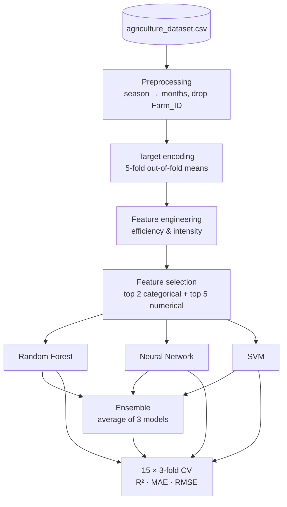

# Forecasting Agriculture: Crop Yield Prediction

**Predicting crop yield with Random Forest, Neural Network and SVM models in MATLAB**

---

A MATLAB machine-learning pipeline that predicts **crop yield (tons)** from farm characteristics and input usage. It compares three tuned regression models and an ensemble that averages them, scoring each with repeated k-fold cross-validation.

## Table of Contents

- [Features](#features)
- [Repository Structure](#repository-structure)
- [Dataset](#dataset)
- [Methodology](#methodology)
- [Getting Started](#getting-started)
- [Outputs](#outputs)
- [Notes](#notes)
- [Acknowledgements](#acknowledgements)

## Features

- **Leak-free target encoding:** categorical features are encoded with 5-fold out-of-fold means
- **Feature engineering:** efficiency and chemical-intensity features
- **Importance-based feature selection:** grouped bagged-tree importance
- **Bayesian hyperparameter tuning:** for all three models
- **Ensemble model:** an equal-weight average of RF, NN and SVM predictions
- **Robust evaluation:** 15 × repeated 3-fold CV with R², MAE and RMSE boxplots

## Repository Structure

```text
forecasting-agriculture/
├── ForecastingAgriculture.m   # Full pipeline: preprocessing → tuning → evaluation → plots
└── README.md
```

## Dataset

**Source:** [Agriculture and Farming Dataset](https://www.kaggle.com/datasets/bhadramohit/agriculture-and-farming-dataset) by `bhadramohit` on Kaggle

> [!IMPORTANT]
> The dataset is **not included** in this repository. Download it from Kaggle (a free account is required) and save it as **`agriculture_dataset.csv`** in the same folder as `ForecastingAgriculture.m`.

<details>
<summary><b>Expected columns</b></summary>

MATLAB's `readtable` turns special characters in headers into underscores, so `Farm_Area(acres)` becomes `Farm_Area_acres_`.

| Column (as read by MATLAB) | Type | Description |
|---|---|---|
| `Farm_ID` | ID | Dropped before modelling |
| `Crop_Type` | Categorical | Crop grown |
| `Farm_Area_acres_` | Numeric | Farm area (acres) |
| `Irrigation_Type` | Categorical | Irrigation method |
| `Fertilizer_Used_tons_` | Numeric | Fertilizer used (tons) |
| `Pesticide_Used_kg_` | Numeric | Pesticide used (kg) |
| `Yield_tons_` | Numeric | **Target:** crop yield (tons) |
| `Soil_Type` | Categorical | Soil classification |
| `Season` | Categorical | Kharif / Rabi / Zaid. Must be the **9th column** |
| `Water_Usage_cubicMeters_` | Numeric | Water usage (m³) |

</details>

## Methodology



<details>
<summary><b>1. Preprocessing</b></summary>

Maps each crop season to its months:

| Season | Months |
|---|---|
| Kharif | June–October |
| Zaid | March–May |
| Rabi | November–February |

The script stops with an error if it finds any other season value. The `Farm_ID` identifier is dropped.

</details>

<details>
<summary><b>2. Target encoding</b></summary>

The categorical features (`Crop_Type`, `Irrigation_Type`, `Soil_Type` and `Season`) are replaced with the **mean yield of their category**. The means are computed out-of-fold over 5 folds, so no row is encoded with its own target value. Categories that don't appear in a training fold fall back to the global training mean.

</details>

<details>
<summary><b>3. Feature engineering</b></summary>

| Feature | Definition (z-scored) |
|---|---|
| `Fertilizer_Efficiency` | Yield ÷ fertilizer used |
| `Water_Efficiency` | Yield ÷ water usage |
| `Chemical_Intensity` | (fertilizer + pesticide) ÷ farm area |

</details>

<details>
<summary><b>4. Feature selection</b></summary>

A quick bagged-tree ensemble (`fitrensemble`, `'Bag'`) scores **predictor importance**. The scores are summed per feature group, and the script keeps the **top 2 categorical** and **top 5 numerical** groups. Change these counts with `N_category` and `N_numerical`.

</details>

<details>
<summary><b>5. Models and hyperparameter tuning</b></summary>

Each model is tuned with MATLAB's built-in **Bayesian optimization** (3-fold CV) and then refit on the full data with its best hyperparameters.

| Model | Function | Tuned hyperparameters | Max evaluations | Input |
|---|---|---|:-:|---|
| Random Forest | `fitrensemble` (Bag) | `NumLearningCycles`, `MinLeafSize`, `MaxNumSplits`, `NumVariablesToSample` | 25 | Raw |
| Neural Network | `fitrnet` | `LayerSizes`, `Lambda` | 20 | Z-scored |
| SVM | `fitrsvm` | `KernelFunction`, `BoxConstraint`, `KernelScale` | 20 | Z-scored |

</details>

<details>
<summary><b>6. Evaluation</b></summary>

- **15 repeats of 3-fold cross-validation**, with a fresh partition each repeat, for every model.
- A **combined** model averages the RF, NN and SVM predictions equally.
- Metrics: **R² (%)**, **MAE** and **RMSE**.

</details>

## Getting Started

### Prerequisites

- **MATLAB R2021a or later**, because `fitrnet` was introduced in R2021a
- **Statistics and Machine Learning Toolbox**

### Installation

```bash
git clone https://github.com/gyles-hsh/forecasting-agriculture.git
cd forecasting-agriculture
```

Then [download the dataset](https://www.kaggle.com/datasets/bhadramohit/agriculture-and-farming-dataset) and save it in this folder as `agriculture_dataset.csv`.

### Usage

In MATLAB, set the repository folder as the current folder and run:

```matlab
ForecastingAgriculture
```

> [!NOTE]
> The script clears the workspace and closes open figures before it starts. Tuning runs 65 Bayesian-optimization evaluations, and evaluation trains 4 models × 15 repeats × 3 folds, so a full run can take several minutes or more.

## Outputs

**Console**
- Ranked feature groups (categorical, numerical and combined)
- The features selected for modelling
- Mean R², MAE and RMSE for each model and the ensemble

**Figures**
- One figure per model (RF, NN, SVM and Combined) with **boxplots of R², MAE and RMSE** across the 15 repeats. Each boxplot is annotated with its min, Q1, median, mean, Q3 and max.
- A **feature-importance** dashboard with three panels: categorical groups, numerical groups and all groups combined.

## Notes

> [!TIP]
> The script doesn't set a random seed, so results vary slightly between runs. Add `rng(42)` (or any seed) at the top of the script for reproducible results.

## Acknowledgements

The dataset comes from the [Agriculture and Farming Dataset](https://www.kaggle.com/datasets/bhadramohit/agriculture-and-farming-dataset), published on Kaggle by `bhadramohit`. See the Kaggle page for its license and terms of use.
